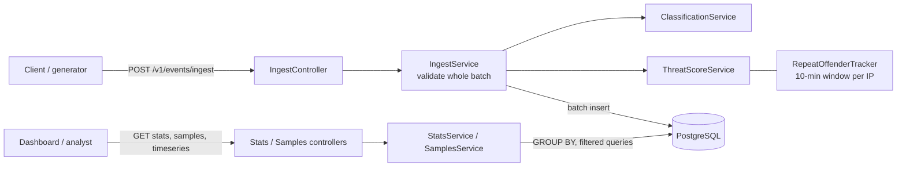

# Mini WSA

A small security analytics pipeline in the spirit of Akamai's Web Security Analytics. It ingests security
events (DLRs), classifies and scores them, stores them in PostgreSQL and serves analytics over a REST API.

- Java 21, Spring Boot 3, PostgreSQL 16, Flyway, Maven
- Ingest (single or batch) with validation, enrichment (`attackType`, `threatScore`), summary stats, sample
  browsing with pagination, a time-series endpoint (the bonus), and a seeded data generator with attack waves

## Quick start

### Docker (recommended)

```bash
docker compose up --build
```

This starts PostgreSQL and the app on <http://localhost:8080>. The schema is created automatically by Flyway.

Load some data (10,000 events including attack waves), using the app image so no local Java is needed:

```bash
docker compose run --rm --no-deps --entrypoint java app \
  -Dloader.main=com.akamai.miniwsa.generator.GeneratorRunner -cp app.jar \
  org.springframework.boot.loader.launch.PropertiesLauncher --count 10000 --post http://app:8080
```

### Local build (Java 21 + Maven)

```bash
docker compose up -d postgres        # database only
mvn package -DskipTests              # builds target/mini-wsa-*.jar
java -jar target/mini-wsa-*.jar      # http://localhost:8080
scripts/generate.sh --count 10000 --post http://localhost:8080
```

Database settings default to `localhost:5432`, database/user/password `miniwsa`. Override with the usual
Spring variables (`SPRING_DATASOURCE_URL`, `SPRING_DATASOURCE_USERNAME`, `SPRING_DATASOURCE_PASSWORD`).

### Tests

```bash
mvn test
```

Unit tests need nothing. The API tests start a real PostgreSQL with Testcontainers, so **Docker must be
running**. (If your Docker engine rejects Testcontainers with "client version 1.32 is too old", run
`mvn test -DargLine="-Dapi.version=1.44"`.)

### Data generator

`scripts/generate.sh` (needs a built jar) or the Docker command above. Options:

| Option | Default | Meaning |
|---|---|---|
| `--count N` | 10000 | number of events |
| `--seed N` | 42 | same seed gives the same events |
| `--hours N` | 24 | length of the time range |
| `--to ISO_TIME` | now | end of the time range |
| `--out FILE` | stdout | write a JSON array; it can be POSTed to the API as is |
| `--post URL` | | POST batches to `URL/v1/events/ingest` instead of writing |
| `--batch-size N` | 500 | events per POST |

About 70% of events are background traffic from a pool of 200 clients across three site configurations and
14 rules covering every category. The other 30% are **attack waves**: 30 to 120 events from one IP, against
one path, with one rule, a few seconds apart, mostly `DENY`. Events are emitted in timestamp order.

## API

Errors always look like this (HTTP 400):

```json
{ "status": 400, "message": "Validation failed",
  "errors": [ { "index": 1, "field": "path", "message": "must not be blank" } ] }
```

`index` is the position in the batch and is omitted for query-parameter errors. Timestamps are ISO 8601 UTC.
Time ranges are `from` inclusive, `to` exclusive.

### `POST /v1/events/ingest`

Accepts one event or an array. Returns `201` with the number accepted.

```bash
curl -X POST localhost:8080/v1/events/ingest -H 'Content-Type: application/json' -d '{
  "eventId": "evt-00132", "timestamp": "2026-05-20T14:32:10Z", "configId": 14227, "policyId": "pol_web1",
  "clientIp": "203.0.113.42", "hostname": "www.example.com", "path": "/api/v1/login", "method": "POST",
  "statusCode": 403, "userAgent": "Mozilla/5.0 (Windows NT 10.0; Win64; x64)",
  "rule": { "id": "950001", "name": "SQL_INJECTION", "message": "SQL Injection Attack Detected",
            "severity": "CRITICAL", "category": "INJECTION" },
  "action": "DENY", "geoLocation": { "country": "CN", "city": "Beijing" },
  "requestSize": 1024, "responseSize": 256 }'
# {"accepted":1}
```

Required: `eventId`, `timestamp`, `configId`, `clientIp`, `path`, `method`, `rule` (with `id`, `name`,
`severity`, `category`) and `action`. Enums: `severity` CRITICAL/HIGH/MEDIUM/LOW; `category` INJECTION, XSS,
PROTOCOL_VIOLATION, DATA_LEAKAGE, BOT, DOS, RATE_LIMIT; `action` DENY/ALERT/MONITOR. Bad enum values and
unparseable timestamps are reported per event and field (for example `rule.severity`).

- **A batch is all or nothing**: if any event is invalid, nothing is stored and every problem is listed.
- **Ingestion is idempotent**: an event whose `eventId` already exists is skipped (and still counted in
  `accepted`), so a client can safely retry a batch.

To ingest a generated file: `curl -X POST localhost:8080/v1/events/ingest -H 'Content-Type: application/json' -d @events.json`.

### `GET /v1/stats/summary`

`from` and `to` are required, `configId` is optional (omit it to aggregate all configurations).

```bash
curl 'localhost:8080/v1/stats/summary?configId=14227&from=2026-05-20T00:00:00Z&to=2026-05-21T00:00:00Z'
```

```json
{
  "configId": 14227,
  "timeRange": { "from": "2026-05-20T00:00:00Z", "to": "2026-05-21T00:00:00Z" },
  "totalEvents": 1523,
  "byCategory": { "INJECTION": { "count": 450, "avgThreatScore": 72.3 },
                  "BOT": { "count": 380, "avgThreatScore": 45.1 } },
  "byAction": { "DENY": 890, "ALERT": 433, "MONITOR": 200 },
  "topAttackers": [ { "clientIp": "203.0.113.42", "count": 87, "avgThreatScore": 81.2 } ],
  "topTargetedPaths": [ { "path": "/api/v1/login", "count": 234 } ]
}
```

The top lists hold 10 entries ordered by event count (ties broken alphabetically). Averages are rounded to one
decimal. Categories and actions with no events are left out.

### `GET /v1/events/samples`

All parameters are optional: `configId`, `from`, `to`, `category`, `action`, `limit` (default 20, 1 to 100) and
`offset` (default 0).

```bash
curl 'localhost:8080/v1/events/samples?configId=14227&category=INJECTION&action=DENY&limit=2&offset=0'
```

```json
{ "total": 450, "limit": 2, "offset": 0,
  "items": [ { "eventId": "evt-00132", "timestamp": "2026-05-20T14:32:10Z", "configId": 14227,
               "clientIp": "203.0.113.42", "path": "/api/v1/login", "rule": { "...": "..." },
               "action": "DENY", "receivedAt": "2026-05-20T14:32:11.482Z",
               "attackType": "SQL/Command Injection", "threatScore": 75 } ] }
```

Newest first, with `eventId` as a tie-breaker so pages never overlap. `total` counts all matches. Values outside
the allowed `limit` range are rejected with 400 rather than silently clamped.

### `GET /v1/stats/timeseries` (bonus)

```bash
curl 'localhost:8080/v1/stats/timeseries?configId=14227&from=2026-05-20T00:00:00Z&to=2026-05-20T01:00:00Z&interval=5m'
```

```json
{ "configId": 14227, "interval": "5m",
  "timeRange": { "from": "2026-05-20T00:00:00Z", "to": "2026-05-20T01:00:00Z" },
  "buckets": [ { "start": "2026-05-20T00:00:00Z", "count": 41 },
               { "start": "2026-05-20T00:05:00Z", "count": 0 } ] }
```

`interval` is `1m`, `5m` or `1h` and is required. Buckets are aligned to the clock and gaps are filled with
`count: 0`, so the series can be charted directly. A range spanning more than 5,000 buckets is rejected.

## Threat score

Integer 0 to 100, computed at ingestion:

| Factor | Points |
|---|---|
| Severity: CRITICAL / HIGH / MEDIUM / LOW | 40 / 30 / 20 / 10 |
| Action: DENY / ALERT / MONITOR | +20 / +10 / +0 |
| Path contains `/admin` or `/login` | +15 |
| Repeat offender: more than 5 earlier events from the same IP in the 10 minutes up to this event | +15 |

The result is capped at 100. With these weights the highest reachable score is 90, so the cap never triggers
today; it is kept so the contract holds if weights change.

`attackType` maps from the category: INJECTION is "SQL/Command Injection", XSS is "Cross-Site Scripting",
PROTOCOL_VIOLATION is "Protocol Anomaly", DATA_LEAKAGE is "Data Exfiltration", BOT is "Bot Activity", DOS is
"Denial of Service" and RATE_LIMIT is "Rate Limiting".

## Architecture



Code layout (`com.akamai.miniwsa`):

| Package | Responsibility |
|---|---|
| `api` | HTTP only: controllers and the error handler. No business logic. |
| `ingest` | Validation of a batch, then enrich and store. |
| `enrich` | Classification, threat scoring, repeat-offender window. Pure logic, so it is easy to unit test. |
| `stats`, `samples` | Query-side services: parameter rules, assembling responses. |
| `storage` | `EventRepository` interface and the PostgreSQL implementation. The only place with SQL. |
| `generator` | Data generator, independent of the web layer. |
| `model` | Records and enums shared by the layers. |

All aggregation happens in SQL (one `GROUP BY` per section), nothing is aggregated in Java. Filters share one
`EventFilter` and one WHERE builder. Column names that reach SQL come from an enum, never from request input.

## Storage choice

**PostgreSQL**, with the events table flattened into one row per event and indexed on `(config_id, ts DESC)`,
`(ts DESC)` and `(client_ip, ts)`.

Why: the workload is append-heavy with analytical reads, but at this scale what matters is correctness and
simplicity. Postgres gives strong SQL for the aggregations (`GROUP BY`, `date_bin`), transactions for atomic
batch inserts, and a primary key that makes ingestion idempotent. It is also trivial to run and test with
Testcontainers.

Where it stops scaling, and what I would do at "real" WSA volume (millions of events per minute):

- Wide aggregate scans over row storage get slow, and each index costs write throughput. The natural next step is
  a **columnar store such as ClickHouse** (or Druid/Pinot), fed through **Kafka**, which also decouples ingestion
  from storage. The `EventRepository` interface is the seam for that swap.
- Short of replacing it: range-partition by month on `ts` (drop old partitions instead of deleting), BRIN
  indexes for time, rollup tables or materialised views for the summary, and read replicas.
- `count(*)` and deep `OFFSET` in the samples API get slower as the table grows. Use keyset pagination and
  approximate or capped totals.

## Design decisions and assumptions

- **"Last 10 minutes" uses event time**, not wall-clock time. The window is measured against the event's
  `timestamp`, so replayed or generated data scores the same however fast it is loaded. Events are counted in
  the order they are ingested, so out-of-order data is scored on what has been seen so far.
- **Repeat-offender** means more than 5 *earlier* events in the window; the current event is not counted.
- **The repeat-offender window is in memory**: per instance, empty after a restart, and idle IPs are not evicted.
  See the improvements below.
- **Whole-batch rejection** keeps clients simple (nothing to reconcile after a 400).
- `receivedAt` is set once per request by the server clock.

## Testing

- Unit tests: classification (every category), scoring (every branch, bonuses stacking, the cap), the
  repeat-offender window (boundaries, independent IPs, out-of-order), and the generator (determinism, ordering,
  validity, category coverage, attack-wave shape, and that waves actually trigger the repeat-offender bonus).
- API tests against a real PostgreSQL: ingestion (single, batch, validation errors, atomic rejection, duplicates,
  stored values), stats, samples (filters, pagination, flat output) and the time series.

## What I would improve with more time

- Put a queue (Kafka) between ingestion and storage, with async batched writes and back-pressure, and move
  analytics to a columnar store (see above).
- Keep the repeat-offender state in Redis (or derive it from a time-bounded query) so it survives restarts and
  works across several instances; evict idle IPs.
- Keyset pagination for samples; cached or approximate totals; partitioning and rollup tables.
- Authentication, per-tenant authorisation on `configId`, rate limiting, request size limits.
- Metrics and health endpoints (Actuator, Prometheus), structured logging, and load tests with a measured
  ingest throughput instead of estimates.
- Alerting rules on top of the stats (the other bonus option), and OpenAPI documentation generated from code.

## Challenges

- **Useful validation errors for batches.** A plain `@Valid` list gives vague errors, and malformed values (bad
  enum, bad timestamp) fail inside Jackson before validation runs. I validate each event with Bean Validation
  to get `{index, field}` errors, and translate Jackson's mapping exceptions (using their path) into the same
  shape, so the client sees one consistent error format.
- **Defining the repeat-offender rule.** The wording leaves open what "within the last 10 minutes" is measured
  against and whether the current event counts. I chose event time and "earlier events only", wrote them down
  above, and covered the boundaries with tests.
- **Test infrastructure.** Sharing one Spring context across several Testcontainers-based test classes broke
  when the container was stopped after the first class, so the container is started once for the whole run.
  Separately, a recent Docker engine rejected the old default Docker API version used by Testcontainers (see
  the Tests section for the workaround).
- **Generating believable data.** Uniform random events make dull analytics. Attack waves from a single IP
  against a single path, with a fixed seed, give the stats and the repeat-offender logic something real to
  show, and keep the output reproducible.

## One thing I learned

PostgreSQL's `date_bin` (14+) buckets timestamps to arbitrary intervals aligned to an origin, which is what the
time-series endpoint needs: `date_trunc` only handles calendar units, so `5m` buckets would otherwise need
awkward arithmetic. Using an epoch origin keeps buckets aligned to the clock, and the same alignment is
reproduced in Java to fill empty buckets with zeros. I learned it by reading the docs and then writing a test
that pins the alignment, including a range that starts in the middle of a bucket.

## Milestones

| Tag | Content |
|---|---|
| `v0.1-ingestion` | Ingest endpoint, validation, `receivedAt` |
| `v0.2-enrichment` | Classification, threat score, PostgreSQL + Flyway, docker-compose |
| `v0.3-stats` | `GET /v1/stats/summary` |
| `v0.4-samples` | `GET /v1/events/samples` with filters and pagination |
| `v0.5-generator` | Seeded generator with attack waves |
| `v0.6-timeseries` | `GET /v1/stats/timeseries` (bonus) |
| `v1.0` | Documentation |
